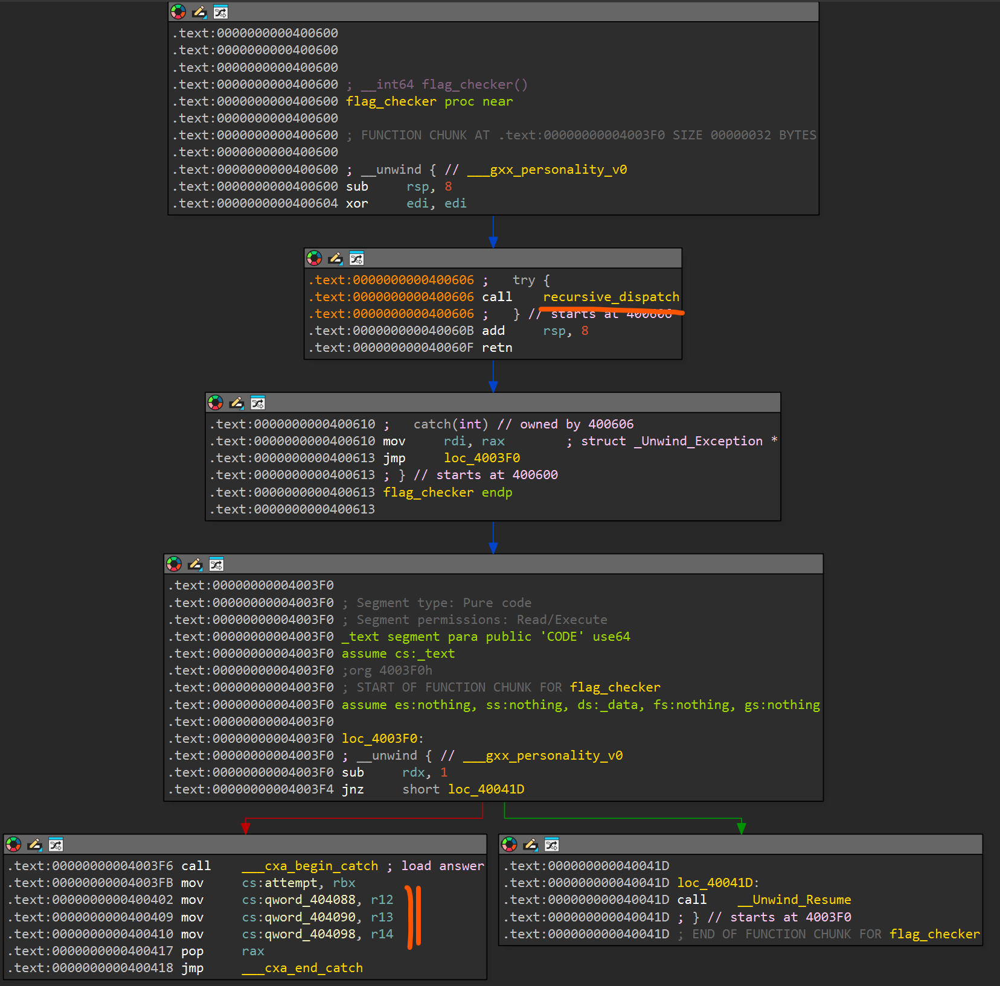
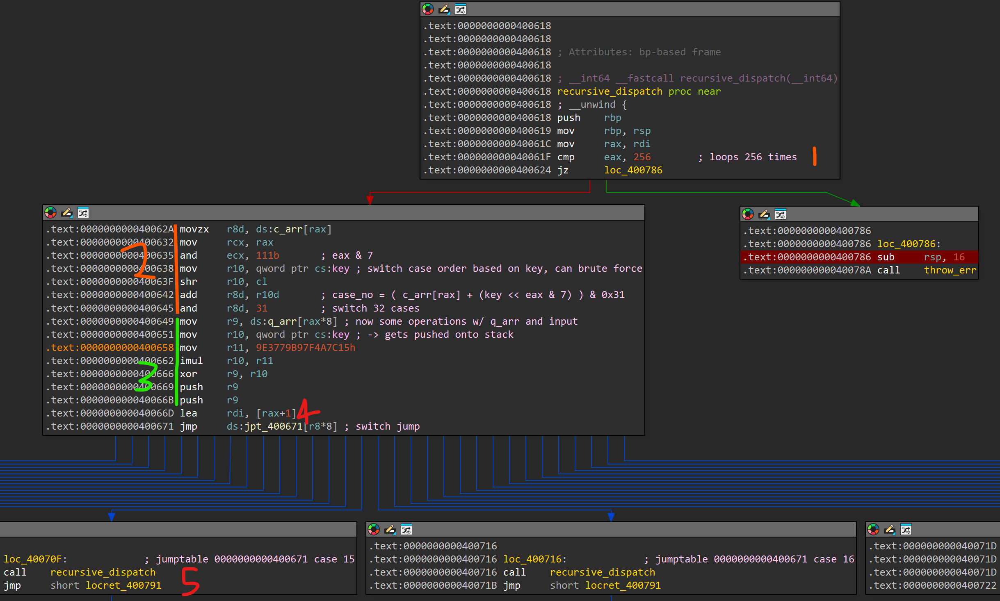
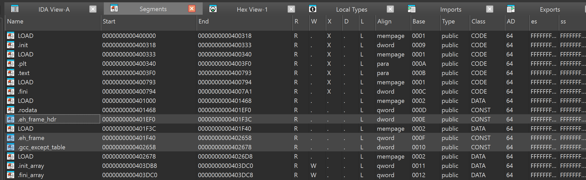
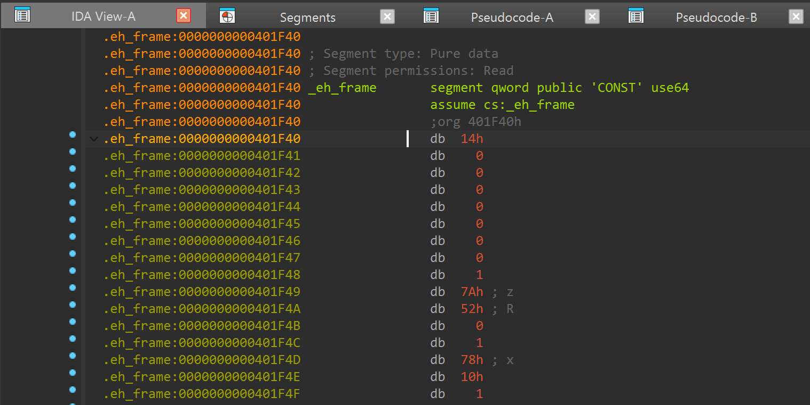

# small guy

> A small guy once told me something special. Life hasn't been the same ever since
> - 0xle

## Analysis

### Initial Triage
A quick look at the binary tells us that this is a flag checker binary that takes in 32 bytes (excl. flag header), transforms it, then compares it against a hardcoded array `answer`:

```c
__int64 __fastcall main(int argc, char **argv, char **envp)
{
  char (*user_input)[32]; // rbx
  size_t input_len; // rax
  int v6; // eax
  const char *v7; // rdi

  if ( argc != 2 )
  {
    printf(format: "usage: %s NNS{...}\n", *argv);
    return 1;
  }
  user_input = argv[1];
  input_len = strlen(s: user_input);
  if ( input_len > 5 )
  {
    if ( *user_input == '{SNN' && (*user_input)[input_len - 1] == '}' )
    {
      user_input = (user_input + 4);
      input_len -= 5LL;
    }
    if ( input_len == 32 )                      // excl flag header, 32 bytes
    {
      *input_p1 = _mm_loadu_si128(user_input);
      input_p2 = _mm_loadu_si128(&(*user_input)[16]);
      key = *unk_4D0000;
      flag_checker();
      v6 = memcmp(s1: attempt, s2: answer, n: 32u);
      v7 = "Correct!";
      if ( v6 != 0 )
        v7 = "Wrong.";
      puts(s: v7);
      return 0;
    }
  }
  printf(format: "the small guy only understands %zu characters\n", 0x20u);
  return 1;
}
```

From the disassembly, we also see that the first 2 bytes of the input gets loaded into the global variable `key`:

```assembly
.text:00000000004004AA
.text:00000000004004AA loc_4004AA:
.text:00000000004004AA movdqu  xmm0, xmmword ptr [rbx]
.text:00000000004004AE movups  xmmword ptr cs:input_p1, xmm0
.text:00000000004004B5 movdqu  xmm0, xmmword ptr [rbx+10h]
.text:00000000004004BA movzx   eax, word ptr cs:input_p1 ; // HERE
.text:00000000004004C1 movups  xmmword ptr cs:input_p2, xmm0
.text:00000000004004C8 mov     qword ptr cs:key, rax ; // HERE
.text:00000000004004CF call    flag_checker
```

Examining `flag_checker` at `0x400600`, the decompilation is very short, but the disassembly reveals that the function contains a `try/catch` block, which explains why some of its code appears to be missing:



From here, we observe that:

1. The main logic is probably in `recursive_dispatch`
2. Based on the bottom-left disassembly, the user input was probably loaded into rbx, r12, r13 and r14

### Analysis of dispatch logic

Moving on to `recursive_dispatch` at `0x400618`, we can analyze the disassembly and come up with the following:

```python
1. The function 'executes' 256 times before an error is thrown, where `eax` represents the current index
2. `case_no = ( c_arr[rax] + (key >> eax & 7) ) & 0x31`
   -> switch case order is based on `key` i.e. first 2 bytes of user input (can brute force!)
3. `r9 = q_arr[rax*8] ^ (key * 0x9E3779B97F4A7C15)`
   -> gets pushed to stack for some reason, probably used later
4. `eax` gets incremented before each call
5. Each switch case calls `recursive_dispatch`
   -> why??
```



### Finding the hidden control flow

At this point, I was a little confused. The transformed user input should have been loaded into rbx, r12-r14, but this was nowhere to be seen. After some careful thinking, I considered that the logic could be hidden in some sort of exception handling segment and went to dig around:

 

Based on the segment names, I filtered down to 3 possible locations where the control flow could be hidden. Then, because `.eh_frame` was much larger than the other 2 segments, I chose to focus on that first.

Looking at the segment in IDA, it just looks like a bunch of random bytes. I tried converting it to code and offsets but that didn't work out too well:



After some searching online, I found two useful articles to help understand `.eh_frame` better:

- https://refspecs.linuxfoundation.org/LSB_3.0.0/LSB-Embedded/LSB-Embedded/ehframechpt.html
- https://maskray.me/blog/stack-unwinding
- https://dwarfstd.org/doc/040408.1.html

Rough summary of what I learnt:

- `.eh_frame` contains stack unwinding metadata for reconstructing call frames (i.e. when an exception is thrown)
- Format contains >= 1 CFI records, and each CFI contains a CIE followed by >= 1 FDE
  - One CIE per .obj file -> contains a list of FDEs
  - each FDE associated with a function
  - CFA = Canonical Frame Address (stable ref pt. for a function's stack frame)
- We can user `readelf -wf ./small_guy` help parse the `.eh_frame` segment

### Interpreting the DWARF operations

- Operations are executed on a stack machine
- Since the first throw is at 0x40078a, we examine it first:
  ```python
  Truncated output of `readelf -wf ./small_guy`
  
  DW_CFA_advance_loc: 4 to 000000000040078a  # 0x40078a <= PC < 0x40078f
  DW_CFA_remember_state  # run these rules
  DW_CFA_val_expression: r2 (rcx) (DW_OP_lit0)
  DW_CFA_val_expression: r3 (rbx) (DW_OP_addr: 4d0000; DW_OP_deref)  # set rbx = *0x4d0000
  DW_CFA_val_expression: r12 (r12) (DW_OP_addr: 4d0008; DW_OP_deref)
  DW_CFA_val_expression: r13 (r13) (DW_OP_addr: 4d0010; DW_OP_deref)
  DW_CFA_val_expression: r14 (r14) (DW_OP_addr: 4d0018; DW_OP_deref)
  
  # these don't get ran    
  DW_CFA_advance_loc: 5 to 000000000040078f
  DW_CFA_restore_state
  
  ...
  ```
- Then assuming the latest switch case to call `recursive_dispatch` is the switch case 0, this gets executed:
  ```python
  DW_CFA_advance_loc1: 93 to 0000000000400679  # jump to switch0
  DW_CFA_remember_state  # SAVE state
  DW_CFA_offset_extended: r2 (rcx) at cfa-24  # set RCX = cfa - 24 (i.e. r9)
      
  # set rbx += 11400714819323198485
  DW_CFA_val_expression: r3 (rbx) (DW_OP_breg3 (rbx): 0; DW_OP_constu: 11400714819323198485; DW_OP_plus)
      
  DW_CFA_advance_loc: 5 to 000000000040067e
  DW_CFA_restore_state
  
  ...
  ```
  - So when switch0 unwinds, it actually does `rbx += 11400714819323198485`
  - Note that this addition is applied during stack unwinding, not when it first reaches the switch case!
  - Also, later switch cases get executed first

### Solution Path

We can basically work backwards using the final output bytes that the transformed flag gets compared against:

- Last switch case gets executed ... till the first switch case that did call `resursive_dispatch` to get final output
  - We transform the final output by:
    1. Execute the operations from first to last switch case
    2. Each switch case operation should be <u>reversed</u>
- We also need to brute-force the seed (first 2 bytes of input) to get the correct switch case order

#### Final Script

```python
bits_64 = pow(2, 64) - 1

def get_case_order(key=b"eb"):
    c_arr = bytes.fromhex("0C0F05190C000B03080A081F1611001F0D1B1C1F091917121C0B1810001C121003070111110F011518130E0F0610171D1C13131A101E0D17051719171B0F04090700010B1809131B011A021A0C0B130A0F1A101D07010F17110D150D110F060C08021C1808071C1A1100080D0E1915041C0815101F121102070E0D02060319031F080F0A0C0519030F17061E0E1B011C05090415190B011B0F140A051408041910010A0917110906130E1F121A0203041D0C00081E061E110B0C05051F0E0B04100710000913060E14041D1B191515091C1716191E0613161C17170E001B04081817140B0E1C1B130F16191E0A1A0B110001051709151F1E08190A1805071F0D")
    _input = int.from_bytes(key[::-1])  # r10, 2 ascii bytes to determine switch case order, [::-1] because input taken into register as little endian
    q_arr = bytes.fromhex("901142D72BA58E1CC57EE64E43361E2F354D500A0AA9EE010DC8568885004546BD36EBDB5D4CA801E19D2213C7B050A8FD5B8CDE7ADAC677B6FB85599A62FF082DCEC7D8F3B3D1851BE4B410FBBE77E682A64F57389DE92DD745AF9BBECF9A6D1761F7F47AD1EB884F60423696E48494EC336680D1B5EC6017C72F7F9F0A7435A36A6EDE836F0D6D589FB459C596C1483EBB303C8B15C8D4B758F2FD7CEE8B3EC84DD922045E6038882308853AAF5F73A61D9EADE5210CC6EFE95C3A00A983B5F38B2F50ABEE5C2533286B321B7FCAF061B58FE6BC7173978F79AC998F2FF4A5AAD925EAA5B9FC39ED7A7F4338B4CA68389E8F71B831F5D7F852F182C27799A397FFB5219B0CE3CE9329934AE01F2EC73D06682E210CFE2E05157E3C66F37F341D9DA692DCA4A8A80F603DE6DA25307CF384F97B7F291ABC812BD4DD4F57E804208BAA3C371231299080695EF3633C1EEE02379F9A432A04F031D2D963DBAC0008EAF12F6E3D6D3FA8252572F91BDB969D45A378DA08E319A31E650747911518A2C489135C7C1923BBA6B89193831BB7AA5EEAF7B789043AC253887C9EF47E7D3EAB109E18D3C5FD3A220541892E7F19961D3B314590417814CA57CD6D90B89183DA690AEE82A02387F263DFD86AA52317635744B8F674F6D25CD6FE9A5C5850428AB1DEEC4B330ACCC37F13DEAFD4EAFE6FFF5A4C23A9D5A40586F9EF4B6843A1E60160CF77933F615D54DA7748196E9C3C97FBDB69F6D65CDD860685664ACE4E30671533219B446540DEB04FF72D843636CAE4384C76C8132C642DE0E59C70C1405B7012B6C068FEF4E4810015FAFB6705E02E849932B67EE7AC2CA65BA8989D3D7B577466593D193EC20A9D983BA088C36F5DFCF39BD60671393218C79DF894919908A4018B7D2920EE4523B1CC6ECD1B23BCDC0E0D52390926CCC381141BA13E67601AB4EFCA4E54DFD4937FC412204A7CA7AEE6FAD658BE4E175F5BE6906CA53FCBA3996929F9C720AC16F83041D8E69BBC8A43997133BC8F15A7FAAC2DF3BE5EAA1CB3ACC6CE8F304665CF4562421BBF59BAF0EB60DC13B95EDB2AF609035095287BE0CF687CC0F9EA19F1ADEE4B28CCE6187793C3D5FFD2DDE9FCDDDD2FCB15159EAB4CC260A04D0D0A58E7469CDF65F070C7381B3DFF45CDF40B8A796A12FBAC3AF74ED10DE0E85D4B85140C087AE44D3BFEB33A548128647E1CFA4D970CE2E420EEDECA64893ACC34B7D9D50E2BD156F558A1C3082866CAB4C61FEB4274011B0557DBC5A38F20B0ACADBF42EA05990550696636C3EFFCF1F70A85FF86383720D8A22C9C1F4E8A142B2B5A66FC818EAF5F2109B75FD4ABC2F967CAF46029E956E8C1384AAF634B348AC0FF83C9B2C75A604014246260B0304C68477B0EB5D391C749DC2AA7035E7756CBFDBF0BFB46AAE179A7BBC2F31D99404457B75B411A6FD2B0D047B15BC45502CE85CC0085B2D24388220D5C503684264B71FEA890F3B97312B0D9375AD3A43F569135BEA9EBEA7FEE3C7FFF0451C0D76B93196CE748049720810ECF52407406A16D6C5027D826EECA35802AFCBF5753A6D716C17E461C96C642A2CDC55E86BD7D56F674DC6397C3B434BB791997409D23469C33D0C6B57A899603DAA050BF3988B406368505A0687EA830E6BEB4F7F65B2E4F4BAF3B50DA6A58404D0C1CC00DC43C6F82258994BFA7A3A3CE27483AE6235EE7DFFACA7084FC652F1B0BA2F78896DEDD257E2A528A28C347F8227839B9C5FC8D0A62343141BF89B910CA9CA76643B268F3152B5D9C740979E1E839D1214E2DB7CDDF683CEDD9CBF5576E70EFA20C7A1821C7D20BD072D171BA97CF5671335508B49AD028A871E17EC3101EC5C3914C50F970400799A2BA39E089E273E8536286828C5C0C8A6EA42372B93000BF72CB4C6F241E7C3ACD54CA8DE82BFFAA084B26F3CD53DA475132263E8E53A16BDC0E0F356A02D924331BC6D34A923007EE6D7A9074380718F05AAE6492A8727385AF7FB7E49DE7135C4280569171AD68360E2172B08335E7014DA60FF561CAE7FDC5549B0BE24276237583BACAA57920BD6A341B97A9F48AB8F23EFFA496713D6CA0D0B902B4A50D63D0E6EA98842183B8A657A6F264FDAC27FF1D962E5767F13054398E3F82296BE4469FF3899A21E5DDB72F9BF7469164F0F0CD7886625516AC30D8E7AC2957EB8D01661D9CE4806EF2085CE24645EDFC4AE55D4CB2004C615E6E7AB701702CD1C1C62EF6856B1D428C9C3A9E7D5DDFBF768119F5B84DC9BA9E65E79DB13E27D5F637296FCA32507B012F06FB75896B9B16CF5B414207DD4F9DA5763D2AA6933C7152DA37234D85134EE33104AD2F3A55BCDBC2862BF44810BD3F4CC4F034455D1E95ACEE9FF1EBD4EFE2F631FBA73CB906FB7721F4392CC1EFF3CBE34575471DDB5F6ABDBDBF35B0092B7D127EE3D30BB13F25CDEE33EC2745902A0F3FCBC7CD688D4CA1A5D8A59706F56F5A22000B8575370B2C1C21CA0504669FA4E5A70C91E051390D40B656D7EF68121C581D3F757E8C6722F3A64A7EFF7FC2489F514B2E8E22AD1A15664907654C55890440253AD7F32FDAAC1A43E4918A53692020F54869796488D71667A3D813E8D256B04D142D9A7ECE8831CB2263D749BDD3002A5407D2F11B173166DAFDFFA5A6E2AB024098B0A593F795C9DCC7D78F2D65526F04C5A1FE65E0813052660FEC3C5E898B6BEB7467A33A14B9F895E32DFAAC1056150CC3AF27EACD87571AAC7581683771B4EEB186C2DB617D83DBC083A9D03A1A7C508F018E4C1A5CB585EDA90B58B40F05990060C0ADE61AC594392ECFD96ED2E24FF75A03583B3279AB252D1094E4BF2044AA0C98E0F986A2A96833E91B4DCAB454ABA8DE59C4CDBF8508CF")
    
    i = 0
    cases = []
    while i < 256:
        rcx = i & 0b111
        r10 = _input >> rcx
        r8d = c_arr[i] + r10
        r8d &= 31
        #print(i, "| case", r8d, "|", hex(c_arr[rcx]), hex(r10))
        i += 1
        # rcx value from CFA
        op1 = (_input * 0x9E3779B97F4A7C15) & bits_64
        op2 = int.from_bytes(q_arr[i*8:i*8+8], "little")
        cases.append((r8d, (op1 ^ op2) & bits_64))
    return cases

def parse():
    mappings = {}
    with open("parse.txt", "r") as f:
        _id = -1
        for line in f.readlines():
            if "DW_CFA_remember_state" in line:
                _id += 1
                continue
            if "DW_CFA_val_expression" in line and _id % 2 == 0:
                line = line.replace("DW_CFA_val_expression: ", "")
                if _id // 2 not in mappings:
                    mappings[_id // 2] = [line]
                else:
                    mappings[_id // 2].append(line)

    for _id in mappings:
        mappings[_id] = mappings[_id]
        #print(_id, "   ".join(mappings[_id]))

class Registers:
    def __init__(self):
        self.rbx = 0x1BC6F31C128E799D
        self.r12 = 0x91434B88502F7096
        self.r13 = 0x0B66209EC964BCE23
        self.r14 = 0x0B4E75307D14B54F3
        self.rcx = 0

    def set_rcx(self, new):
        self.rcx = new

def case0(): r.rbx = (r.rbx - 11400714819323198485) & bits_64
def case1(): r.r12 = (r.r12 - 13787848793156543929) & bits_64
def case2(): r.r13 = (r.r13 - 10723151780598845931) & bits_64
def case3(): r.r14 = (r.r14 - 2685821657736338717) & bits_64

def case4(): r.rbx = (r.rbx - 15485907386658061715) & bits_64
def case5(): r.r12 = (r.r12 - 11562461410679940143) & bits_64
def case6(): r.r13 = (r.r13 - 16646288086500911323) & bits_64
def case7(): r.r14 = (r.r14 - 10285213230658275043) & bits_64

def case8():  r.rbx ^= ((r.r12 >> 57) | (r.r12 << 7)) & bits_64
def case9():  r.r12 ^= ((r.r13 >> 47) | (r.r13 << 17)) & bits_64
def case10(): r.r13 ^= ((r.r14 >> 35) | (r.r14 << 29)) & bits_64
def case11(): r.r14 ^= ((r.rbx >> 23) | (r.rbx << 41)) & bits_64

def case12(): 
    modinv = pow(6364136223846793005, -1 , pow(2, 64))
    r.rbx = (r.rbx * modinv) & bits_64

def case13():
    modinv = pow(2862933555777941757, -1, 1 << 64)
    r.r12 = (r.r12 * modinv) & bits_64

def case14():
    modinv = pow(3935559000370003845, -1, 1 << 64)
    r.r13 = (r.r13 * modinv) & bits_64

# fwd is def case15(): r.r14 = (r.r14 * 18397679294719823053) & bits_64
def case15():
    modinv = pow(18397679294719823053, -1, 1 << 64)
    r.r14 = (r.r14 * modinv) & bits_64

def case16(): r.rbx ^= r.rcx
def case17(): r.r12 ^= r.rcx
def case18(): r.r13 ^= r.rcx
def case19(): r.r14 ^= r.rcx

def case20(): r.rbx = (r.rbx - r.rcx * 14029467366897019727) & bits_64
def case21(): r.r12 = (r.r12 - r.rcx * 1609587929392839161) & bits_64
def case22(): r.r13 = (r.r13 - r.rcx * 9650029242287828579) & bits_64
def case23(): r.r14 = (r.r14 - r.rcx * 11400714785074694791) & bits_64

def case24(): r.rbx ^= ((r.r13 >> 53) | (r.r13 << 11)) & bits_64
def case25(): r.r12 ^= ((r.r14 >> 41) | (r.r14 << 23)) & bits_64
def case26(): r.r13 ^= ((r.rbx >> 27) | (r.rbx << 37)) & bits_64
def case27(): r.r14 ^= ((r.r12 >> 11) | (r.r12 << 53)) & bits_64

def case28(): temp = r.rbx; r.rbx = r.r13; r.r13 = temp
def case29(): temp = r.r12; r.r12 = r.r14; r.r14 = temp

def case30():
    count = (r.rcx & 3) + 1
    while count:
        r.rbx = (r.rbx - 2567483615) & bits_64
        inverse = pow(1812433253, -1, pow(2, 64))
        r.rbx = (r.rbx * inverse) & bits_64
        count -= 1

def case31():
    count = (r.rcx & 3) + 1
    while count:
        r.r13 = (r.r13 - 12345) & bits_64
        inverse = pow(1103515245, -1, pow(2, 64))
        r.r13 = (r.r13 * inverse) & bits_64
        count -= 1

cases = [case0, case1, case2, case3, case4, case5, case6, case7, case8, case9, case10, case11, case12, case13, case14, case15, case16, case17, case18, case19, case20, case21, case22, case23, case24, case25, case26, case27, case28, case29, case30, case31]

for k1 in range(32, 127):
    for k2 in range(32, 127):
        key = chr(k1).encode() + chr(k2).encode()
        if key == b"un":
            case_order = get_case_order(key)
            r = Registers()
            for data in case_order:
                i, rcx = data
                r.set_rcx(rcx)
                print(
                    f"case {i}", "\n"
                    "rbx", hex(r.rbx), "\n"
                    "r12", hex(r.r12), "\n"
                    "r13", hex(r.r13), "\n"
                    "r14", hex(r.r14), "\n"
                    "rcx", hex(r.rcx), "\n"
                )
                cases[i]()

            fail = False
            for b in r.rbx.to_bytes(8, "little"):
                if b < 32 or b > 127:
                    fail = True

            if not fail:
                print(r.rbx.to_bytes(8, "little") + \
                    r.r12.to_bytes(8, "little") + \
                    r.r13.to_bytes(8, "little") + \
                    r.r14.to_bytes(8, "little"))


# & pow(2, 64) - 1
# is equivalent to 
# % pow(2, 64)

"""
def fwd_case15(): x = (x * 18397679294719823053) % pow(2, 64)
def rev_case15():
    modinv = pow(18397679294719823053, -1, pow(2, 64))
    x = (x * modinv) % pow(2, 64)
    
3x % 16 = 15
3x ≡ 15 (mod 16)

i want to "divide by 3" to get x
but in modular arithmetic, i get that by
multiplying by the mod inv. of 3

inv = pow(3, -1, 16)
x = (15 * inv) % 16
"""
```

#### Debugging

```bash
r NNS{ebcdefghijklmnopqrstuvwxyz123456}
b _Unwind_RaiseException
c
bt
frame 256
info registers rbx r12 13 14
```

## Appendix

### Forward Operations

```python
def case0(): r.rbx = (r.rbx + 11400714819323198485) & bits_64
def case1(): r.r12 = (r.r12 + 13787848793156543929) & bits_64
def case2(): r.r13 = (r.r13 + 10723151780598845931) & bits_64
def case3(): r.r14 = (r.r14 + 2685821657736338717) & bits_64

def case4(): r.rbx = (r.rbx + 15485907386658061715) & bits_64
def case5(): r.r12 = (r.r12 + 11562461410679940143) & bits_64
def case6(): r.r13 = (r.r13 + 16646288086500911323) & bits_64
def case7(): r.r14 = (r.r14 + 10285213230658275043) & bits_64

def case8(): r.rbx ^= ((r.r12 >> 57) | (r.r12 << 7)) & bits_64
def case9(): r.r12 ^= ((r.r13 >> 47) | (r.r13 << 17)) & bits_64
def case10(): r.r13 ^= ((r.r14 >> 35) | (r.r14 << 29)) & bits_64
def case11(): r.r14 ^= ((r.rbx >> 23) | (r.rbx << 41)) & bits_64

def case12(): r.rbx = (r.rbx * 6364136223846793005) & bits_64
def case13(): r.r12 = (r.r12 * 2862933555777941757) & bits_64
def case14(): r.r13 = (r.r13 * 3935559000370003845) & bits_64
def case15(): r.r14 = (r.r14 * 18397679294719823053) & bits_64

def case16(): r.rbx ^= r.rcx
def case17(): r.r12 ^= r.rcx
def case18(): r.r13 ^= r.rcx
def case19(): r.r14 ^= r.rcx

def case20(): r.rbx = (r.rbx + r.rcx * 14029467366897019727) & bits_64
def case21(): r.r12 = (r.r12 + r.rcx * 1609587929392839161) & bits_64
def case22(): r.r13 = (r.r13 + r.rcx * 9650029242287828579) & bits_64
def case23(): r.r14 = (r.r14 + r.rcx * 11400714785074694791) & bits_64

def case24(): r.rbx ^= ((r.r13 >> 53) | (r.r13 << 11)) & bits_64
def case25(): r.r12 ^= ((r.r14 >> 41) | (r.r14 << 23)) & bits_64
def case26(): r.r13 ^= ((r.rbx >> 27) | (r.rbx << 37)) & bits_64
def case27(): r.r14 ^= ((r.r12 >> 11) | (r.r12 << 53)) & bits_64

def case28(): temp = r.rbx; r.rbx = r.r13; r.r13 = temp
def case29(): temp = r.r12; r.r12 = r.r14; r.r14 = temp

def case30():
    count = (r.rcx & 3) + 1
    while count:
        r.rbx = (r.rbx * 1812433253 + 2567483615) & bits_64
        count -= 1

def case31():
    count = (r.rcx & 3) + 1
    while count:
        r.r13 = (r.r13 * 1103515245 + 12345) & bits_64
        count -= 1
```

### readelf

```python
readelf -wf <file>

Contents of the .eh_frame section:

-32:r9  # push r9 at 0x40066B
-24:r9  # push r9 at 0x400669
-16:rbp
-8:retaddr
0:CFA (base ref. before call insn)

00000100 0000000000000610 00000104 FDE cie=00000000 pc=0000000000400618..0000000000400793

# setup
DW_CFA_advance_loc: 1 to 0000000000400619  # executes 400618 (push rbp)
DW_CFA_def_cfa_offset: 16  # cfa = rsp + 16
DW_CFA_offset: r6 (rbp) at cfa-16  # call insn pushes retaddr onto stack, then `push rbp` another +8 to stack
DW_CFA_advance_loc: 3 to 000000000040061c  # executes 400619 (mov rbp, rsp)
DW_CFA_def_cfa_register: r6 (rbp)  # cfa = rbp + 16 instead (change rsp -> rbp )


# huge jump!
#.text:0000000000400679 loc_400679:             ; jumptable 0000000000400671 case 0
#.text:0000000000400679 call    compare
#.text:000000000040067E jmp     locret_400791
# the call pushes retaddr 40067e, so 0x400679 <= pc < 0x40067e is the DW_CFA range as shown below

DW_CFA_advance_loc1: 93 to 0000000000400679  # jump to switch0
DW_CFA_remember_state  # SAVE state
DW_CFA_offset_extended: r2 (rcx) at cfa-24  # set RCX = cfa - 24 (i.e. r9)
# set rbx += 11400714819323198485
DW_CFA_val_expression: r3 (rbx) (DW_OP_breg3 (rbx): 0; DW_OP_constu: 11400714819323198485; DW_OP_plus)
DW_CFA_advance_loc: 5 to 000000000040067e  # executes `call compare()`
DW_CFA_restore_state  # RESTORE TO WHAT? DOES THIS REMOVE RBX?

# so when switch0 unwinds, it actually does rbx += 11400714819323198485
# note that this addition is applied during stack unwinding, not when it first reaches the switch case!
# this is the key missing information!
```


